<!-- Header -->

  

  

  
  
  

  

## 🤖 Claude Code, by the numbers

  <picture>
    <source media="(prefers-color-scheme: dark)" srcset="assets/claude-usage-dark.svg" />
    
  </picture>

## 🧭 How I work with AI

  <picture>
    <source media="(prefers-color-scheme: dark)" srcset="assets/ai-loop-dark.svg" />
    
  </picture>

<b>What each part means</b>

 

<table>
  <tr>
    <th width="50%" align="left">🔁 Every task</th>
    <th width="50%" align="left">🫀 Keeping it current</th>
  </tr>
  <tr>
    <td valign="top">

**1 · Ask** in plain words. The right skill loads only when it's needed.

**2 · Check** read-only first: the record, the logs, the host.

**3 · Act** only after a yes. Anything that restarts, erases or re-enrols a device waits for my OK.

**4 · Verify** the real result. A green CI job isn't done; the database row or host state is.

**5 · Save** the learning into the runbook it belongs to, in three places, the same turn.

**6 · Add a check** so the same kind of miss can't slip through again.

🔐 And through all of it: **the AI never sees a password.**

  </td>
    <td valign="top">

**Every save** · quick lint on the files that changed.

**Every miss** · fix it everywhere, add the guard that would have caught it, log a changelog row.

**Every blocked command** · a verdict in a registry: keep blocked, fixed, or safe to allow.

**Weekly** · full lint report, plus a security check of the Mac.

**Every 14 days** · a canary runs each access path for real, read-only, to catch breakage early.

**Every 30 days** · CI job and workflow inputs compared with the last snapshot, to catch drift.

**Monthly** · evals re-run on a smaller model, so skills don't depend on the biggest one.

**Always** · secrets live in an auto-locking keychain. Never in notes, never in chat.

  </td>
  </tr>
</table>

## 🧪 Built with AI

Real tools I use, built by pairing with Claude Code. Each card opens the write-up: **the problem, how it was built and what I learned,** and names where the ideas came from. Side builds marked *Repo* open the full project with code and a step-by-step guide.

#### At work

<a href="https://github.com/Parag-S-Salunkhe/Parag-S-Salunkhe/blob/main/ai-lab/ai-ops-copilot/README.md"><picture><source media="(prefers-color-scheme: dark)" srcset="assets/cards/ai-ops-copilot-dark.svg" />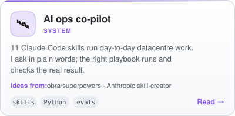</picture></a>
<a href="https://github.com/Parag-S-Salunkhe/Parag-S-Salunkhe/blob/main/ai-lab/self-checking-runbooks/README.md"><picture><source media="(prefers-color-scheme: dark)" srcset="assets/cards/self-checking-runbooks-dark.svg" />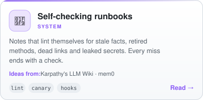</picture></a>
<a href="https://github.com/Parag-S-Salunkhe/Parag-S-Salunkhe/blob/main/ai-lab/zero-password-agent-access/README.md"><picture><source media="(prefers-color-scheme: dark)" srcset="assets/cards/zero-password-agent-access-dark.svg" />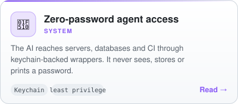</picture></a>
<a href="https://github.com/Parag-S-Salunkhe/Parag-S-Salunkhe/blob/main/ai-lab/device-troubleshooting-agent/README.md"><picture><source media="(prefers-color-scheme: dark)" srcset="assets/cards/device-troubleshooting-agent-dark.svg" />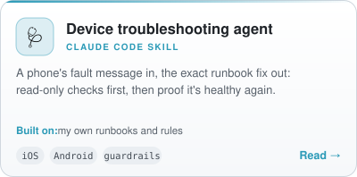</picture></a>
<a href="https://github.com/Parag-S-Salunkhe/Parag-S-Salunkhe/blob/main/ai-lab/faulty-device-autofix/README.md"><picture><source media="(prefers-color-scheme: dark)" srcset="assets/cards/faulty-device-autofix-dark.svg" />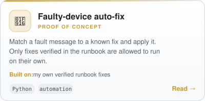</picture></a>
<a href="https://github.com/Parag-S-Salunkhe/Parag-S-Salunkhe/blob/main/ai-lab/pxe-golden-image/README.md"><picture><source media="(prefers-color-scheme: dark)" srcset="assets/cards/pxe-golden-image-dark.svg" />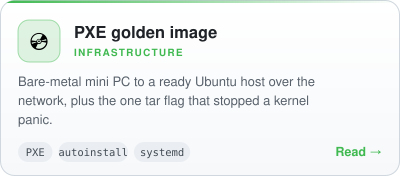</picture></a>

<b>➕ Show 6 more skills</b> (5 at work, 1 personal)

 

<a href="https://github.com/Parag-S-Salunkhe/Parag-S-Salunkhe/blob/main/ai-lab/rca-skill/README.md"><picture><source media="(prefers-color-scheme: dark)" srcset="assets/cards/rca-skill-dark.svg" />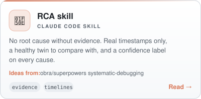</picture></a>
<a href="https://github.com/Parag-S-Salunkhe/Parag-S-Salunkhe/blob/main/ai-lab/onboarding-autopilot/README.md"><picture><source media="(prefers-color-scheme: dark)" srcset="assets/cards/onboarding-autopilot-dark.svg" />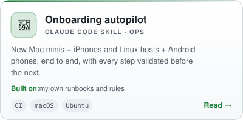</picture></a>
<a href="https://github.com/Parag-S-Salunkhe/Parag-S-Salunkhe/blob/main/ai-lab/ci-workflow-helper/README.md"><picture><source media="(prefers-color-scheme: dark)" srcset="assets/cards/ci-workflow-helper-dark.svg" />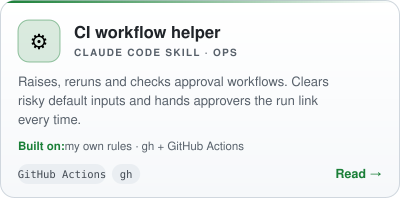</picture></a>
<a href="https://github.com/Parag-S-Salunkhe/Parag-S-Salunkhe/blob/main/ai-lab/security-guard/README.md"><picture><source media="(prefers-color-scheme: dark)" srcset="assets/cards/security-guard-dark.svg" />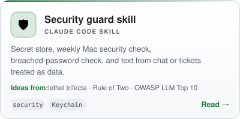</picture></a>
<a href="https://github.com/Parag-S-Salunkhe/Parag-S-Salunkhe/blob/main/ai-lab/save-learnings/README.md"><picture><source media="(prefers-color-scheme: dark)" srcset="assets/cards/save-learnings-dark.svg" />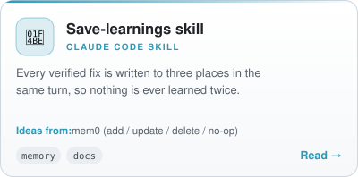</picture></a>
<a href="https://github.com/Parag-S-Salunkhe/Parag-S-Salunkhe/blob/main/ai-lab/linkedin-writing-skill/README.md"><picture><source media="(prefers-color-scheme: dark)" srcset="assets/cards/linkedin-writing-skill-dark.svg" />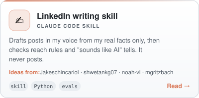</picture></a>

<a href="https://github.com/Parag-S-Salunkhe/Parag-S-Salunkhe/blob/main/ai-lab/README.md">All 16 write-ups on one page →</a>

#### Side builds

<a href="https://github.com/Parag-S-Salunkhe/Parag-S-Salunkhe/blob/main/ai-lab/personal-website/README.md"><picture><source media="(prefers-color-scheme: dark)" srcset="assets/cards/personal-website-dark.svg" />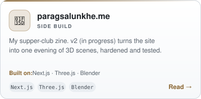</picture></a>
<a href="https://github.com/Parag-S-Salunkhe/mac-desktop-widgets"><picture><source media="(prefers-color-scheme: dark)" srcset="assets/cards/mac-desktop-widgets-dark.svg" />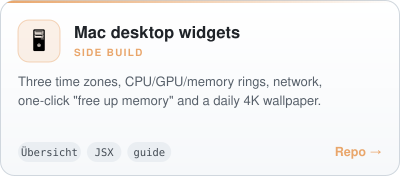</picture></a>
<a href="https://github.com/Parag-S-Salunkhe/galaxy-watch4"><picture><source media="(prefers-color-scheme: dark)" srcset="assets/cards/galaxy-watch-faces-dark.svg" />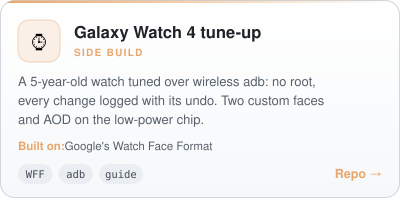</picture></a>
<a href="https://github.com/Parag-S-Salunkhe/Parag-S-Salunkhe/blob/main/ai-lab/parents-phones/README.md"><picture><source media="(prefers-color-scheme: dark)" srcset="assets/cards/parents-phones-dark.svg" />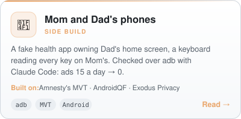</picture></a>

#### Claude Code skills

The 17 skills anyone can use, in two groups, with the ideas each one is built on. The repo has every skill, its credits and a guide to writing your own.

<a href="https://github.com/Parag-S-Salunkhe/claude-code-skills"><picture><source media="(prefers-color-scheme: dark)" srcset="assets/cards/claude-code-skills-shelf-dark.svg" /></picture></a>

## ☁️ Cloud & DevOps projects

Hands-on builds from my AWS and Kubernetes learning, each with a step-by-step guide in the repo.

<a href="https://github.com/Parag-S-Salunkhe/go-application-devops"><picture><source media="(prefers-color-scheme: dark)" srcset="assets/cards/project-go-application-devops-dark.svg" /></picture></a>
<a href="https://github.com/Parag-S-Salunkhe/twotierapp"><picture><source media="(prefers-color-scheme: dark)" srcset="assets/cards/project-twotierapp-dark.svg" /></picture></a>
<a href="https://github.com/Parag-S-Salunkhe/serverless-AWS-deployment"><picture><source media="(prefers-color-scheme: dark)" srcset="assets/cards/project-serverless-AWS-deployment-dark.svg" /></picture></a>

 

  

