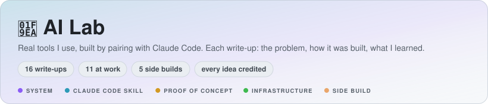
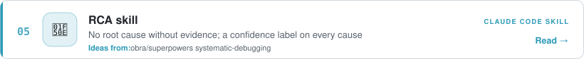
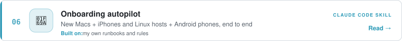
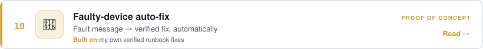
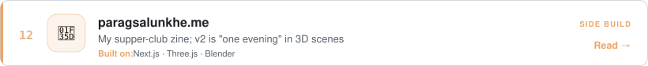
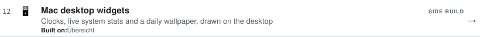
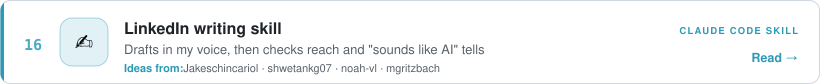

<a href="../README.md"><picture><source media="(prefers-color-scheme: dark)" srcset="../assets/lab/hero-dark.svg" /></picture></a>

### 💼 At work · 01–11

<a href="./ai-ops-copilot/README.md"><picture><source media="(prefers-color-scheme: dark)" srcset="../assets/lab/row-ai-ops-copilot-dark.svg" /></picture></a>
<a href="./self-checking-runbooks/README.md"><picture><source media="(prefers-color-scheme: dark)" srcset="../assets/lab/row-self-checking-runbooks-dark.svg" /></picture></a>
<a href="./zero-password-agent-access/README.md"><picture><source media="(prefers-color-scheme: dark)" srcset="../assets/lab/row-zero-password-agent-access-dark.svg" /></picture></a>
<a href="./device-troubleshooting-agent/README.md"><picture><source media="(prefers-color-scheme: dark)" srcset="../assets/lab/row-device-troubleshooting-agent-dark.svg" /></picture></a>
<a href="./rca-skill/README.md"><picture><source media="(prefers-color-scheme: dark)" srcset="../assets/lab/row-rca-skill-dark.svg" /></picture></a>
<a href="./onboarding-autopilot/README.md"><picture><source media="(prefers-color-scheme: dark)" srcset="../assets/lab/row-onboarding-autopilot-dark.svg" /></picture></a>
<a href="./ci-workflow-helper/README.md"><picture><source media="(prefers-color-scheme: dark)" srcset="../assets/lab/row-ci-workflow-helper-dark.svg" /></picture></a>
<a href="./security-guard/README.md"><picture><source media="(prefers-color-scheme: dark)" srcset="../assets/lab/row-security-guard-dark.svg" /></picture></a>
<a href="./save-learnings/README.md"><picture><source media="(prefers-color-scheme: dark)" srcset="../assets/lab/row-save-learnings-dark.svg" /></picture></a>
<a href="./faulty-device-autofix/README.md"><picture><source media="(prefers-color-scheme: dark)" srcset="../assets/lab/row-faulty-device-autofix-dark.svg" /></picture></a>
<a href="./pxe-golden-image/README.md"><picture><source media="(prefers-color-scheme: dark)" srcset="../assets/lab/row-pxe-golden-image-dark.svg" /></picture></a>

### 🌱 Side builds · 12–16

<a href="./personal-website/README.md"><picture><source media="(prefers-color-scheme: dark)" srcset="../assets/lab/row-personal-website-dark.svg" /></picture></a>
<a href="./mac-desktop-widgets/README.md"><picture><source media="(prefers-color-scheme: dark)" srcset="../assets/lab/row-mac-desktop-widgets-dark.svg" /></picture></a>
<a href="./galaxy-watch-faces/README.md"><picture><source media="(prefers-color-scheme: dark)" srcset="../assets/lab/row-galaxy-watch-faces-dark.svg" /></picture></a>
<a href="./parents-phones/README.md"><picture><source media="(prefers-color-scheme: dark)" srcset="../assets/lab/row-parents-phones-dark.svg" /></picture></a>
<a href="./linkedin-writing-skill/README.md"><picture><source media="(prefers-color-scheme: dark)" srcset="../assets/lab/row-linkedin-writing-skill-dark.svg" /></picture></a>

---

🧰 The skills behind these, ready to install: **[claude-code-skills](https://github.com/Parag-S-Salunkhe/claude-code-skills)** (17 skills, each crediting its sources)

[← back to profile](../README.md)
