# AI Lab

Real tools I use, built by pairing with Claude Code. Each write-up covers the problem, how it was built and what I learned, and credits where the ideas came from.

15 write-ups · 10 at work · 5 side builds

### At work · 01–10

<a href="./ai-ops-copilot/README.md"><picture><source media="(prefers-color-scheme: dark)" srcset="../assets/lab/tile-ai-ops-copilot-dark.svg" />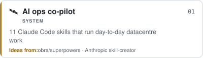</picture></a>
<a href="./self-checking-runbooks/README.md"><picture><source media="(prefers-color-scheme: dark)" srcset="../assets/lab/tile-self-checking-runbooks-dark.svg" />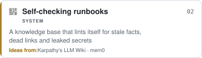</picture></a>
<a href="./zero-password-agent-access/README.md"><picture><source media="(prefers-color-scheme: dark)" srcset="../assets/lab/tile-zero-password-agent-access-dark.svg" />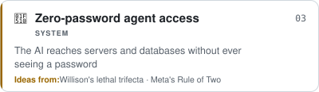</picture></a>
<a href="./device-troubleshooting-agent/README.md"><picture><source media="(prefers-color-scheme: dark)" srcset="../assets/lab/tile-device-troubleshooting-agent-dark.svg" />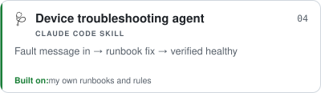</picture></a>
<a href="./rca-skill/README.md"><picture><source media="(prefers-color-scheme: dark)" srcset="../assets/lab/tile-rca-skill-dark.svg" />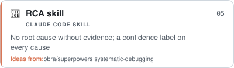</picture></a>
<a href="./onboarding-autopilot/README.md"><picture><source media="(prefers-color-scheme: dark)" srcset="../assets/lab/tile-onboarding-autopilot-dark.svg" />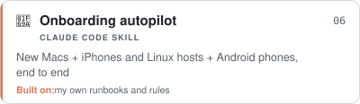</picture></a>
<a href="./ci-workflow-helper/README.md"><picture><source media="(prefers-color-scheme: dark)" srcset="../assets/lab/tile-ci-workflow-helper-dark.svg" />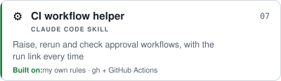</picture></a>
<a href="./security-guard/README.md"><picture><source media="(prefers-color-scheme: dark)" srcset="../assets/lab/tile-security-guard-dark.svg" />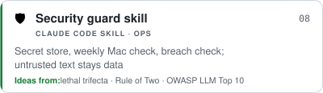</picture></a>
<a href="./save-learnings/README.md"><picture><source media="(prefers-color-scheme: dark)" srcset="../assets/lab/tile-save-learnings-dark.svg" />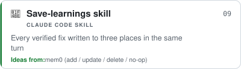</picture></a>
<a href="./pxe-golden-image/README.md"><picture><source media="(prefers-color-scheme: dark)" srcset="../assets/lab/tile-pxe-golden-image-dark.svg" />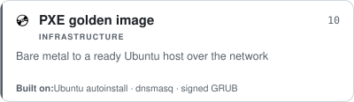</picture></a>

### Side builds · 11–15

<a href="./personal-website/README.md"><picture><source media="(prefers-color-scheme: dark)" srcset="../assets/lab/tile-personal-website-dark.svg" />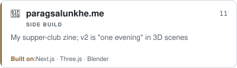</picture></a>
<a href="./mac-desktop-widgets/README.md"><picture><source media="(prefers-color-scheme: dark)" srcset="../assets/lab/tile-mac-desktop-widgets-dark.svg" />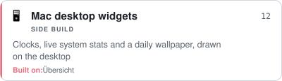</picture></a>
<a href="./galaxy-watch-faces/README.md"><picture><source media="(prefers-color-scheme: dark)" srcset="../assets/lab/tile-galaxy-watch-faces-dark.svg" />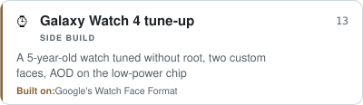</picture></a>
<a href="./parents-phones/README.md"><picture><source media="(prefers-color-scheme: dark)" srcset="../assets/lab/tile-parents-phones-dark.svg" />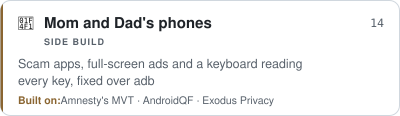</picture></a>
<a href="./linkedin-writing-skill/README.md"><picture><source media="(prefers-color-scheme: dark)" srcset="../assets/lab/tile-linkedin-writing-skill-dark.svg" />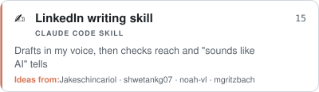</picture></a>

### Claude Code skills · 17

Public and ready to install from [claude-code-skills](https://github.com/Parag-S-Salunkhe/claude-code-skills). Each tile opens the skill; each credits its sources.

<b>Ops &amp; Notes</b>

<a href="https://github.com/Parag-S-Salunkhe/claude-code-skills/blob/main/skills/rca/SKILL.md"><picture><source media="(prefers-color-scheme: dark)" srcset="../assets/lab/skill-rca-dark.svg" />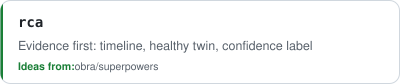</picture></a>
<a href="https://github.com/Parag-S-Salunkhe/claude-code-skills/blob/main/skills/save-learnings/SKILL.md"><picture><source media="(prefers-color-scheme: dark)" srcset="../assets/lab/skill-save-learnings-dark.svg" /></picture></a>
<a href="https://github.com/Parag-S-Salunkhe/claude-code-skills/blob/main/skills/notes-lint/SKILL.md"><picture><source media="(prefers-color-scheme: dark)" srcset="../assets/lab/skill-notes-lint-dark.svg" />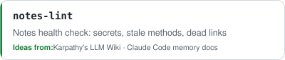</picture></a>
<a href="https://github.com/Parag-S-Salunkhe/claude-code-skills/blob/main/skills/park-it/SKILL.md"><picture><source media="(prefers-color-scheme: dark)" srcset="../assets/lab/skill-park-it-dark.svg" />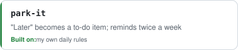</picture></a>
<a href="https://github.com/Parag-S-Salunkhe/claude-code-skills/blob/main/skills/secrets-guard/SKILL.md"><picture><source media="(prefers-color-scheme: dark)" srcset="../assets/lab/skill-secrets-guard-dark.svg" />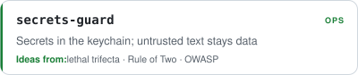</picture></a>
<a href="https://github.com/Parag-S-Salunkhe/claude-code-skills/blob/main/skills/workflow-runner/SKILL.md"><picture><source media="(prefers-color-scheme: dark)" srcset="../assets/lab/skill-workflow-runner-dark.svg" />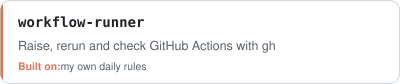</picture></a>
<a href="https://github.com/Parag-S-Salunkhe/claude-code-skills/blob/main/skills/linkedin-post/SKILL.md"><picture><source media="(prefers-color-scheme: dark)" srcset="../assets/lab/skill-linkedin-post-dark.svg" /></picture></a>

<b>Engineering</b>

<a href="https://github.com/Parag-S-Salunkhe/claude-code-skills/blob/main/skills/eng-plan/SKILL.md"><picture><source media="(prefers-color-scheme: dark)" srcset="../assets/lab/skill-eng-plan-dark.svg" /></picture></a>
<a href="https://github.com/Parag-S-Salunkhe/claude-code-skills/blob/main/skills/eng-build/SKILL.md"><picture><source media="(prefers-color-scheme: dark)" srcset="../assets/lab/skill-eng-build-dark.svg" />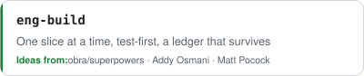</picture></a>
<a href="https://github.com/Parag-S-Salunkhe/claude-code-skills/blob/main/skills/eng-debug/SKILL.md"><picture><source media="(prefers-color-scheme: dark)" srcset="../assets/lab/skill-eng-debug-dark.svg" /></picture></a>
<a href="https://github.com/Parag-S-Salunkhe/claude-code-skills/blob/main/skills/eng-review/SKILL.md"><picture><source media="(prefers-color-scheme: dark)" srcset="../assets/lab/skill-eng-review-dark.svg" /></picture></a>
<a href="https://github.com/Parag-S-Salunkhe/claude-code-skills/blob/main/skills/eng-security/SKILL.md"><picture><source media="(prefers-color-scheme: dark)" srcset="../assets/lab/skill-eng-security-dark.svg" /></picture></a>
<a href="https://github.com/Parag-S-Salunkhe/claude-code-skills/blob/main/skills/eng-design/SKILL.md"><picture><source media="(prefers-color-scheme: dark)" srcset="../assets/lab/skill-eng-design-dark.svg" /></picture></a>
<a href="https://github.com/Parag-S-Salunkhe/claude-code-skills/blob/main/skills/eng-webtest/SKILL.md"><picture><source media="(prefers-color-scheme: dark)" srcset="../assets/lab/skill-eng-webtest-dark.svg" /></picture></a>
<a href="https://github.com/Parag-S-Salunkhe/claude-code-skills/blob/main/skills/eng-evals/SKILL.md"><picture><source media="(prefers-color-scheme: dark)" srcset="../assets/lab/skill-eng-evals-dark.svg" />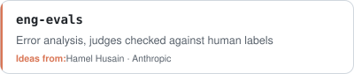</picture></a>
<a href="https://github.com/Parag-S-Salunkhe/claude-code-skills/blob/main/skills/eng-context/SKILL.md"><picture><source media="(prefers-color-scheme: dark)" srcset="../assets/lab/skill-eng-context-dark.svg" /></picture></a>
<a href="https://github.com/Parag-S-Salunkhe/claude-code-skills/blob/main/skills/eng-skills/SKILL.md"><picture><source media="(prefers-color-scheme: dark)" srcset="../assets/lab/skill-eng-skills-dark.svg" />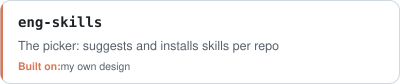</picture></a>

[← back to profile](../README.md)
