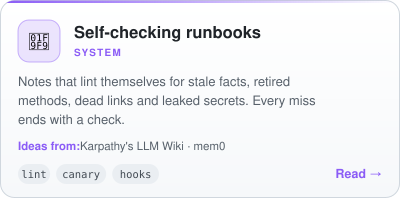
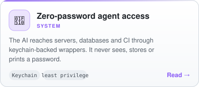
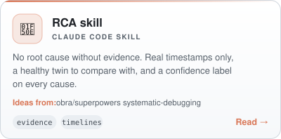
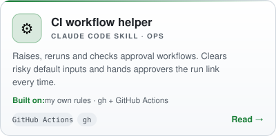
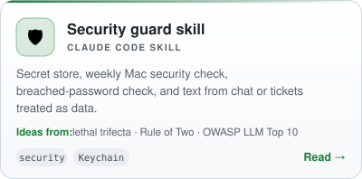
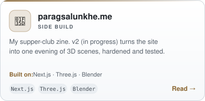
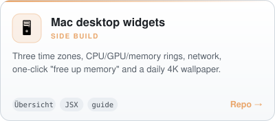
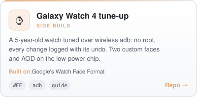
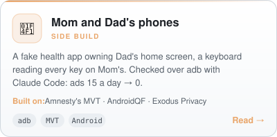
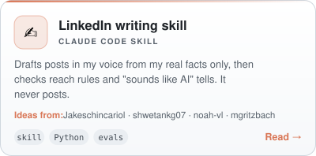

# 🧪 AI Lab

16 things I've built by pairing with [Claude Code](https://claude.com/claude-code). Each one is a real tool I use, not a demo. Every card opens the write-up (**the problem, how it was built and what I learned**) and names where the ideas came from.

### At work (11)

<a href="./ai-ops-copilot/README.md"><picture><source media="(prefers-color-scheme: dark)" srcset="../assets/cards/ai-ops-copilot-dark.svg" /></picture></a>
<a href="./self-checking-runbooks/README.md"><picture><source media="(prefers-color-scheme: dark)" srcset="../assets/cards/self-checking-runbooks-dark.svg" /></picture></a>
<a href="./zero-password-agent-access/README.md"><picture><source media="(prefers-color-scheme: dark)" srcset="../assets/cards/zero-password-agent-access-dark.svg" /></picture></a>
<a href="./device-troubleshooting-agent/README.md"><picture><source media="(prefers-color-scheme: dark)" srcset="../assets/cards/device-troubleshooting-agent-dark.svg" /></picture></a>
<a href="./rca-skill/README.md"><picture><source media="(prefers-color-scheme: dark)" srcset="../assets/cards/rca-skill-dark.svg" /></picture></a>
<a href="./onboarding-autopilot/README.md"><picture><source media="(prefers-color-scheme: dark)" srcset="../assets/cards/onboarding-autopilot-dark.svg" /></picture></a>
<a href="./ci-workflow-helper/README.md"><picture><source media="(prefers-color-scheme: dark)" srcset="../assets/cards/ci-workflow-helper-dark.svg" /></picture></a>
<a href="./security-guard/README.md"><picture><source media="(prefers-color-scheme: dark)" srcset="../assets/cards/security-guard-dark.svg" /></picture></a>
<a href="./save-learnings/README.md"><picture><source media="(prefers-color-scheme: dark)" srcset="../assets/cards/save-learnings-dark.svg" /></picture></a>
<a href="./faulty-device-autofix/README.md"><picture><source media="(prefers-color-scheme: dark)" srcset="../assets/cards/faulty-device-autofix-dark.svg" /></picture></a>
<a href="./pxe-golden-image/README.md"><picture><source media="(prefers-color-scheme: dark)" srcset="../assets/cards/pxe-golden-image-dark.svg" /></picture></a>

### Side builds (5)

<a href="./personal-website/README.md"><picture><source media="(prefers-color-scheme: dark)" srcset="../assets/cards/personal-website-dark.svg" /></picture></a>
<a href="https://github.com/Parag-S-Salunkhe/mac-desktop-widgets"><picture><source media="(prefers-color-scheme: dark)" srcset="../assets/cards/mac-desktop-widgets-dark.svg" /></picture></a>
<a href="https://github.com/Parag-S-Salunkhe/galaxy-watch4"><picture><source media="(prefers-color-scheme: dark)" srcset="../assets/cards/galaxy-watch-faces-dark.svg" /></picture></a>
<a href="./parents-phones/README.md"><picture><source media="(prefers-color-scheme: dark)" srcset="../assets/cards/parents-phones-dark.svg" /></picture></a>
<a href="./linkedin-writing-skill/README.md"><picture><source media="(prefers-color-scheme: dark)" srcset="../assets/cards/linkedin-writing-skill-dark.svg" /></picture></a>

Cards marked <i>Repo</i> open the full project. Their write-ups: <a href="mac-desktop-widgets/README.md">Mac desktop widgets</a> · <a href="galaxy-watch-faces/README.md">Galaxy Watch 4 tune-up</a>

### Claude Code skills (17)

<a href="https://github.com/Parag-S-Salunkhe/claude-code-skills"><picture><source media="(prefers-color-scheme: dark)" srcset="../assets/cards/claude-code-skills-shelf-dark.svg" /></picture></a>

[← back to profile](../README.md)
