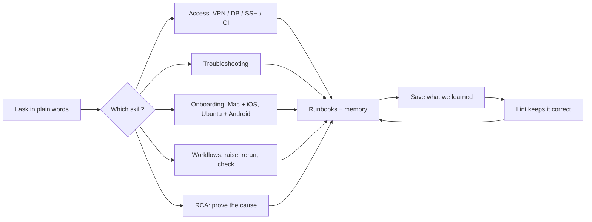

# 🛰️ AI ops co-pilot: 11 Claude Code skills for datacentre work

**Problem.** Datacentre operations for a device-testing cloud means hundreds of small, exact procedures: onboard a new Mac and its iPhones, bring a repaired Android back, fix a device by its fault message, raise the right workflow with the right inputs. The knowledge lived in people's heads, Slack threads and long docs. Every task meant re-finding the steps.

**What I built.** A set of [Claude Code skills](https://docs.claude.com/en/docs/claude-code/skills): folders with a `SKILL.md` playbook plus small scripts. Claude loads one only when the task needs it. I ask in plain words ("onboard this Mac", "why is this phone down", "raise the move-to-prod workflow") and the matching skill runs the procedure with me.

**By the numbers** (from the files themselves)
- 11 skills · ~1,200 lines of playbooks · 25 helper scripts
- Every skill ends by checking the *real* outcome (database row, host state), not the green tick of a job.

**What made it work**
- **Playbooks, not prompts.** Each skill is short: the order of steps and the guardrails. Details live in runbooks it greps by exact keyword, so context stays small.
- **Scripts for anything deterministic.** Queries, SSH and CI calls go through tiny scripts. Claude runs them; it doesn't re-derive them.
- **Guardrails written in.** Read-only checks first. Ask before anything that restarts or erases a device. Report the outcome in one line.
- **Tested across models.** I run the same eval questions on Opus, Sonnet and Haiku and rewrite skills until a smaller model gets them right.
- **It learns.** A "save learnings" skill files every new fix into the right runbook. A [lint](../self-checking-runbooks/) keeps all of it honest.

**Built with:** Claude Code (Opus + Sonnet), Python, Bash, macOS Keychain.

[← AI Lab](../README.md)
