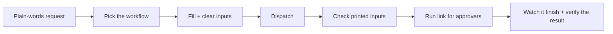

# ⚙️ CI workflow helper

**Problem.** A lot of datacentre changes go through GitHub workflows that need approval: move a device to production, change its status, run a reviewed database query. The inputs are fiddly, a wrong default is easy to miss, and approvers need the exact run link.

**What I built.** A Claude Code skill that raises, reruns and checks those workflows from plain words ("move these to prod", "rerun the failed one").

**Gotchas it handles for me**
- **Pre-filled example inputs.** Some workflows ship with example values in their inputs. Sending an *empty* value through the API silently falls back to that example, so the skill clears them and then **checks the printed inputs** before anyone approves.
- **Quoting for query workflows.** Database queries passed as workflow inputs get quoted the proven way, so they run as reviewed.
- **The run link, every time.** Each reply that raises, reruns or reports a run gives the full link on its own line. Approvers get it straight away instead of hunting in a busy Slack channel.
- **Pick the right tool.** It knows which change belongs in which workflow (or CI job), so status changes don't go through the wrong path.

**Built with:** Claude Code skill, GitHub CLI (`gh`), GitHub Actions.

🧰 **Install a generic version:** [`workflow-runner`](https://github.com/Parag-S-Salunkhe/claude-code-skills/tree/main/skills/workflow-runner) in my [claude-code-skills](https://github.com/Parag-S-Salunkhe/claude-code-skills) repo (same rules, no internal details).

[← AI Lab](../README.md)
