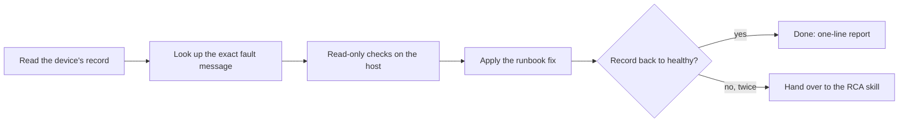

# 🩺 Device troubleshooting agent

**Problem.** In a datacentre of real iPhones and Android phones, devices drop out with a one-line fault message. Each message has a known fix, but it's buried in a runbook, and the fix often needs a careful order (check first, change second, verify last).

**What I built.** A Claude Code skill that takes a device from "faulty" back to "healthy" in four fixed stages:

**Guardrails**
- Exact-text lookup: the fault message is grepped against the runbooks. No guessing from memory.
- Read-only first. Anything that restarts, erases or re-enrolls a phone needs an explicit "yes".
- Not done until the record flips back to healthy (after 2–5 min of propagation).
- Two failed fixes means stop. A separate **RCA skill** must prove the cause from logs, timestamps and a healthy comparison, with a confidence label, before naming it.

**Why it matters.** Fixes stop living in one person's head. Every new fix gets saved into the runbook it came from, so the next one is faster.

**Built with:** Claude Code skills, Python wrappers (see [zero-password access](../zero-password-agent-access/)), Bash over SSH.

[← AI Lab](../README.md)
