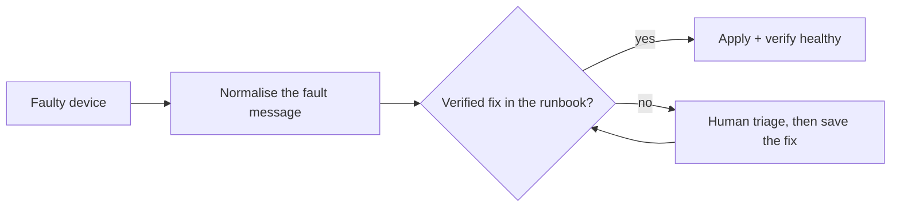

# 🤖 Faulty-device auto-fix (POC)

**Idea.** Most devices that drop out of a device-testing cloud fail for the same handful of reasons, and each reason has a repeatable fix. So: read each faulty device's fault message, match it to a known fix, apply it, and confirm the device is back.

**How the proof of concept works**
- Group faulty devices by their normalised fault message.
- Score each group by **how common it is × how sure we are of the fix**, and start at the top.
- Use the same guardrails as the [troubleshooting agent](../device-troubleshooting-agent/): read-only checks first, no restarts or wipes without a yes, and done only when the record says healthy.

**The lesson that changed the plan.** The first fix list was a set of educated guesses. When we checked them against what really worked, several were wrong. So the rule now: **only fixes verified in the runbook can be automated.** A guess goes to a human first.

**Status:** proof of concept. It grows one verified fix at a time.

**Built with:** Python, read-only database access, Claude Code.

[← AI Lab](../README.md)
