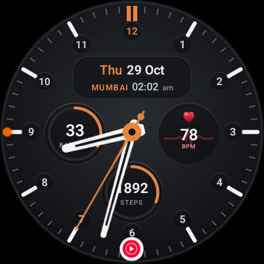
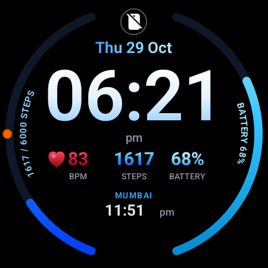
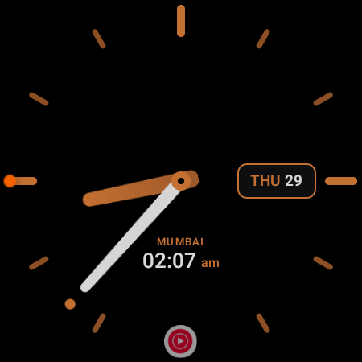

# ⌚ Galaxy Watch faces

📦 **Full project, scripts and a 5-part guide:** [galaxy-watch4](https://github.com/Parag-S-Salunkhe/galaxy-watch4) · 📣 [LinkedIn post](https://www.linkedin.com/feed/update/urn:li:activity:7523319320005722112/)

Two custom faces for my Galaxy Watch 4, written in Google's **Watch Face Format** (XML) and installed over wireless adb. No rooting.

  
  
  

- **Heritage Clean:** analog, charcoal dial, orange/blue accent theme, battery / heart-rate / steps sub-dials, date pill with a second time zone, animated heartbeat on tap.
- **Blue Rings:** bold digital time, gradient progress rings for steps and battery, curved ring labels.

**The interesting bug: blank always-on display.**
The watch has a low-power "offload" chip for the always-on display. The face runtime refuses to offload the whole face if *any* node reads live time data, even a hidden one. The log said `NOT_OFFLOADABLE: Node has a timeDataSource`. Fix: build the AOD from clock elements and fixed date complications only.

**Other gotchas**
- Phone hotspot must be **2.4 GHz only** for the Mac and watch to see each other.
- Wireless debugging turns off on reboot and the port changes. Find it with `dns-sd` (mDNS).
- The watch refuses downgrades. To roll back, rebuild the old version with a higher `versionCode`.

**Built with:** Watch Face Format, Python (asset generation: dials, hands, heart icon, pulse frames), adb, Claude Code.

[← AI Lab](../README.md)
