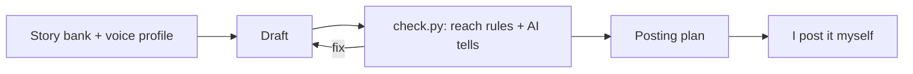

# ✍️ LinkedIn writing skill

**Problem.** I want to post about real work, but drafts either sound like me and nobody reads them, or sound like AI and nobody trusts them.

**What I built.** A Claude Code skill with two modes:
- **Write:** interviews me for one true story, then drafts from my own facts only. Missing numbers stay as `{{your number}}`. It never invents.
- **Review:** runs a local checker script with two passes:
  - a **reach check**: graded rules from research (hook, length, format, links, posting time), each with an evidence grade;
  - an **AI-tell check**: phrases and patterns that make a post read as machine-written.

**Rules it follows:** draft-only (it never posts, comments or likes), my notes are mine (no edits without a yes), and the skill has its own evals.

**Built with:** Claude Code skill, Python checker with self-test, eval set.

[← AI Lab](../README.md)
