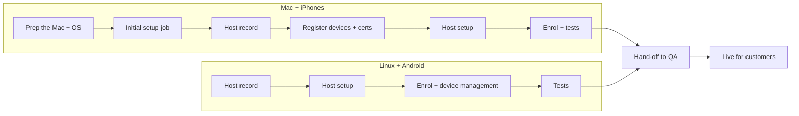

# 🚚 Onboarding autopilot

**Problem.** Bringing new hardware into a device-testing datacentre is a long chain: a new Mac mini and its iPhones, or a Linux host and its Android phones. It takes a dozen steps across CI jobs, workflows and the database. Miss one and the device looks fine but fails its first real test.

**What I built.** Two Claude Code skills, one per platform, that walk the whole chain with me and check each step before the next.

**What makes it reliable**
- **Validate after every step.** A green CI job isn't enough. It reads the real result (database row, host state, the console past the green tick) and reports it in one line.
- **New devices land in a QA pool first,** never straight in front of customers.
- **Failed setup tasks get a targeted rerun** of just the failing part, with known fixes for the usual suspects.
- **Living runbooks.** Every onboarding adds what it taught us, dated and verified, so the next one is faster.

**Results:** new phones go live on launch day, and a repeat onboarding is mostly checking, not remembering.

**Built with:** Claude Code skills, CI (Jenkins + GitHub Actions), Python wrappers, macOS + Ubuntu.

[← AI Lab](../README.md)
