# 📱 Mom and Dad's phones

📣 **LinkedIn post:** [Part 1, Dad's phone](https://www.linkedin.com/feed/update/urn:li:activity:7527501992144035840/)

  <picture>
    <source media="(prefers-color-scheme: dark)" srcset="phones-dark.svg" />
    
  </picture>

**The idea.** I was home for the holidays with 15% of my weekly Claude usage left before the Sunday reset. Dad's phone was throwing full-screen ads and had an app he couldn't uninstall. I plugged it into my laptop and worked through it with Claude Code over adb. The next day it was Mom's turn.

## Two phones, two different problems

| | Dad | Mom |
|---|---|---|
| Phone | Galaxy S10 Lite, no updates since Feb 2024 | Galaxy A36, fully updated |
| The real problem | Speed and ads | Privacy, ads and comfort |
| Full-screen ads a day | 15 → **0** | 17 → **0** |
| Free memory | 1.75 GB → **~3.4 GB** (~4.0 GB a day later) | ~2.8 → ~3.1 GB (it was never short) |
| Storage | **~34 GB freed** (~24 GB of it cache) | 128 → **142 GB free** (~12.3 GB of cache) |
| Apps removed | **30**, plus 7 pre-installed | **14** (83 → 71 apps) |
| Afterwards | A day later: no ads, no new installs | Ads gone, app updates running again |

## Dad's phone: an app that made itself the home screen

- **A fake blood-pressure app had set itself as the Home app.** That's why it "couldn't be uninstalled": Android won't remove the app that is your home screen. Switching Home back to Samsung's launcher made it removable.
- It used about **1.25 GB of memory** and showed **15 full-screen ads in one day**.
- **No camera can measure blood pressure.** Any app that says it can is a scam.
- 30 apps removed, plus 7 pre-installed ones, then about 24 GB of cache cleared.
- Then the comfort bits: Chrome as the default browser, notifications cut to the useful ones, Gboard in the family's languages and animations turned off for speed.
- **A day later:** no ads, no new installs, about 4.0 GB of free memory.

## Mom's phone: newer, still not safe

1. **The ad source was a "document reader" app.** It showed **17 full-screen ads in one day** while she opened documents from WhatsApp. It was 6th on the battery list with about 5 minutes of use, carried 11 ad SDKs, and registered 8 copies of itself in the "Open with" list to crowd other apps out. Drive's viewer and Google Docs were tested on her real files first, then it was removed.
2. **The keyboard could read everything she typed.** A third-party language keyboard with internet, microphone and ad-ID access sees every password and OTP. Gboard was set up for the same languages, typed the same way, and the old keyboard went only once she was happy with it.
3. **The Play Store had been switched off by accident** from the home screen during an app tidy-up a week earlier. No app had been updated since, security fixes included. It's back on.
4. **Scam websites were allowed to send notifications,** granted through the "click Allow to prove you're not a robot" trick. All blocked.
5. **Knock-offs:** a fake "AI Chat" app with 30 ad and tracking SDKs (never opened; the real one was installed), and two file managers named to look like Samsung's own *My Files*. One had all-files access and could draw over other apps; the other opened with a fake "update now" scare ad.
6. **Smaller things:** one-time codes showing on the lock screen (now hidden), and virtual RAM switched on (now off).
7. **Bigger text without broken layouts:** Samsung's Easy mode, bold text and a magnifier on a button shortcut replaced a 1.5× font that was cutting text off.

**The good news:** no spyware, not rooted, no accessibility abuse, no VPN or proxy, and no app allowed to install other apps.

## How it was checked

  <picture>
    <source media="(prefers-color-scheme: dark)" srcset="method-dark.svg" />
    
  </picture>

1. **Look, don't touch.** Read-only checks over adb first: default apps (Home, keyboard, SMS, browser), device admins, accessibility services, VPN and proxy, apps allowed to install apps, usage per app, where each app came from and when, cache per app, notification channels and the battery ranking.
2. **Spyware scan.** [Amnesty's MVT](https://github.com/mvt-project/mvt) on a full bug report, and again on [AndroidQF](https://github.com/mvt-project/androidqf) data: 0 high, 0 critical.
3. **Every app checked.** 338 app files hashed against 3,461 known-bad hashes, and 541 package names against 680 known-bad app IDs: **0 matches**. Then each app's permissions, signing certificate and [Exodus Privacy](https://reports.exodus-privacy.eu.org/en/trackers/) trackers, and a store and developer check on every lesser-known one.
4. **Ask first.** Nothing in use was removed without a yes; only three clearly bad, unused apps holding no data went straight away. Anything holding money, documents or ID was left alone.
5. **Fix.** Clear cache, never Clear data. Test the replacement before removing the old app.
6. **Check again** a day later. On Dad's phone: no ads, no new installs, nothing crashing.

## What went wrong, honestly

- **Android 17 ignores per-app cache clearing from the USB shell.** `pm clear --cache-only` hung forever, and the log said the permission was silently ignored. Nothing was touched. The fix was to drive the Settings screens over adb and tap only "Clear cache".
- **A Back press landed on another app's storage screen,** and one tap was sent without looking. No dialog opened and no data was lost. From then on, the screen was read before every single tap.

## Tips for your parents' phones

1. **A newer phone isn't automatically a safe phone.** Mom's was fully patched and still had adware, a keyboard reading every key and the Play Store switched off.
2. **The keyboard is the most private app on the phone.** Gboard and Samsung Keyboard both handle regional languages.
3. **Never tap "Allow" on a website's notification pop-up.** That's where the "virus found" and "you won" notifications start.
4. **If the Play Store vanishes,** check whether it was switched off: Settings → Apps → Google Play Store → Enable.
5. **"Document reader", "file manager", "AI chat" and "phone cleaner" apps** are often ads dressed up as tools. The phone already has these built in.
6. **An app you can't uninstall** may have made itself your home screen. Switch Home back first: Settings → Apps → Choose default apps → Home app.
7. **Accessibility settings beat a bigger font.** Easy mode, bold text and a magnifier shortcut don't break app layouts.

## What more it can do

- **A ten-minute monthly check** with the same read-only commands, showing only what changed: new apps, new notification permissions, a new default keyboard or Home app.
- **The same steps for any relative's Android phone.** MVT also checks iPhone backups, so the spyware step works there too.
- **Dad now wants to use Claude for his own work,** which may be the best result of the lot.

**Built with:** adb, Claude Code, [MVT](https://github.com/mvt-project/mvt), [AndroidQF](https://github.com/mvt-project/androidqf), the [Exodus Privacy](https://reports.exodus-privacy.eu.org/en/trackers/) tracker list, and Python. Reference for pre-installed apps: [Universal Android Debloater (next generation)](https://github.com/Universal-Debloater-Alliance/universal-android-debloater-next-generation).

[← AI Lab](../README.md)
