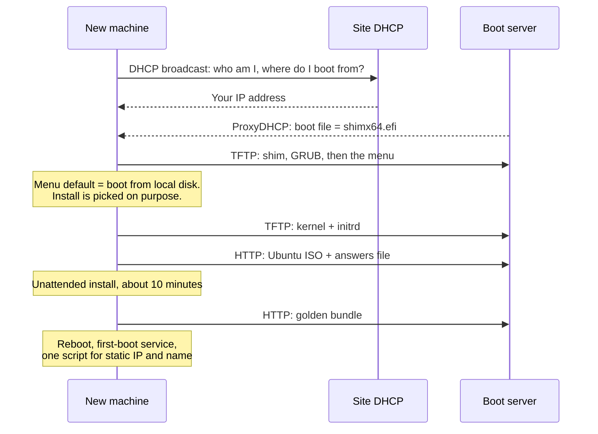

# 💿 PXE golden image

<p align="center">
  <picture>
    <source media="(prefers-color-scheme: dark)" srcset="boot-chain-dark.svg" />
    
  </picture>
</p>

**Goal.** Plug in a new mini PC, boot it from the network, and have it come up as a ready Ubuntu 22.04 host. No USB stick, no monitor, no setup job afterwards.

## PXE in plain words

PXE (Preboot eXecution Environment, said "pixie") is built into the network card and firmware of almost every server and PC. When a machine has nothing on its disk, or is told to boot from the network, the firmware asks the network for something to run. A boot server answers with a small bootloader, the bootloader fetches a Linux kernel, and that kernel installs a whole operating system onto the empty disk.

Why a datacentre cares:

- **No USB sticks, no crash cart.** Nobody wheels a monitor, keyboard and stick from rack to rack. Power on, pick one menu entry.
- **Every host comes out the same.** One answers file decides everything, instead of a person clicking through an installer a little differently each time.
- **A dead disk becomes a short job.** Swap the disk, boot from the network, walk away. Hands-on time is about 15 minutes.
- **A fix happens once.** A bug fixed on the boot server is fixed for every host built after it.
- **Secure Boot stays on.** Every bootloader in the chain is signed.

## What happens after the power button



Two ideas make it work on a network that's already live:

- **ProxyDHCP.** The boot server never hands out addresses and the site's DHCP server isn't touched. The boot server only answers the "where do I boot from?" half of the question. That's why it could be added without changing anything else on the network.
- **TFTP for small, HTTP for big.** PXE firmware fetches its first files over TFTP, which is simple and slow. So TFTP carries just the bootloaders, kernel and initrd. The ISO, the answers file and the bundle come over HTTP.

The whole ProxyDHCP and TFTP side is one dnsmasq file:

```ini
# no DNS, only PXE
port=0
interface=eno1
bind-interfaces
# "proxy": add boot info to the site's DHCP replies, never hand out addresses
dhcp-range=<subnet>,proxy,<netmask>
dhcp-boot=shimx64.efi
pxe-service=BC_EFI,"Install Ubuntu",shimx64.efi
pxe-service=x86-64_EFI,"Install Ubuntu",shimx64.efi
enable-tftp
tftp-root=/srv/tftp
tftp-no-blocksize
log-dhcp
```

## What's our golden ISO?

A **golden image** is the known-good starting point every new machine is built from. There are two ways to make one:

| | Disk clone | Recipe (ours) |
|---|---|---|
| What it is | A copy of one finished disk | The official Ubuntu ISO + an answers file + a small bundle |
| Changing it | Rebuild a machine, capture the disk again | Edit a text file |
| New hardware | Often breaks: drivers, disk names, network names | The installer detects the hardware every time |
| Size on the boot server | The whole disk, per image | The ISO plus a bundle of about 150 MB |
| Knowing what's in it | Whatever was on that disk | Everything is written down |

Ours is the recipe kind. One menu entry builds a host in five layers, and only one of them needs a person:

<p align="center">
  <picture>
    <source media="(prefers-color-scheme: dark)" srcset="golden-layers-dark.svg" />
    
  </picture>
</p>

1. **The stock Ubuntu 22.04 ISO, untouched.** Never modified, so a newer point release is a file swap.
2. **The answers file** (`user-data`, Ubuntu autoinstall): disk layout, user, SSH, packages, and the late-commands that run at the end of the install.
3. **The golden bundle:** a tarball of base tooling and service files, unpacked into the new system before its first reboot.
4. **A one-shot first-boot service** for the settings the installer would otherwise undo.
5. **One script** the technician runs for the static IP and host name. After that the fleet's config agent installs everything else and keeps it current, as it does on every other host.

There's also a self-contained version: the same answers file baked into the ISO itself, so it installs unattended from a USB stick with no boot server at all.

```bash
cp ubuntu-22.04.5-live-server-amd64.iso golden.iso
xorriso -dev golden.iso -boot_image any keep \
  -mkdir /nocloud -- \
  -map user-data /nocloud/user-data -- \
  -map meta-data /nocloud/meta-data -- \
  -update grub.cfg /boot/grub/grub.cfg -- \
  -update loopback.cfg /boot/grub/loopback.cfg -- \
  -commit
# the patched grub.cfg adds to the kernel line:  autoinstall ds=nocloud\;s=/cdrom/nocloud/
```

- `-boot_image any keep` edits the ISO in place and leaves its boot structure alone. Extracting it and rebuilding it with `replay` fails on modern Ubuntu ISOs, which hide an EFI partition in an appended GPT.
- The `--` matters: without it, `-mkdir` swallows every option after it.
- A content-only change (a fixed answers file) is a quick `-update` of that one file, not a full rebuild.

## How it helps: the first real rebuild

A host with a dead disk was rebuilt with nothing but this. No setup job ran afterwards.

| Time | What happened |
|---|---|
| 0 min | Power on, network boot, pick the golden entry |
| ~10 min | Ubuntu installed, bundle unpacked, rebooted by itself |
| ~25 min | Script run: static IP and name set, rebooted |
| ~45 min | The config agent reports the host ready |

Hands-on time was about 15 minutes, and the host went straight back into service: one of its phones was running a real test session within minutes.

## Troubleshooting: symptom, cause, fix

Every row below happened on the way.

| Symptom | Cause | Fix |
|---|---|---|
| The firmware never asks for a boot file | UEFI firmware ignored the boot options in the normal DHCP reply | ProxyDHCP on the boot server, port 4011 open |
| dnsmasq logs `failed sending <file>` | TFTP sends data from a new port. With the kernel's conntrack helper off, the firewall didn't see it as related and dropped it | `net.netfilter.nf_conntrack_helper=1` and load `nf_conntrack_tftp` |
| Boot stops at a `grub>` prompt | GRUB 2.06's network boot couldn't reliably find its own server on this firmware. A second DHCP server on the segment makes it worse | Signed GRUB 2.12 from Ubuntu 24.04's package (same signature chain, Secure Boot still on) fixed most of it. If the other DHCP server answers first it can still happen: type `configfile (tftp,<boot-server>)/grub/grub.cfg` |
| The installer asks every question, as if there were no answers file | One unquoted YAML line containing `: ` made the whole file invalid. cloud-init dropped it without anything on screen | Quote the line, and run a YAML parser on `user-data` before every change goes live |
| The machine reinstalls itself on every reboot | Menu entry 0 was "Install" | Entry 0 is now "Boot from local disk" |
| Kernel panic on first boot | The bundle's real `lib/` folder replaced Ubuntu's `/lib → usr/lib` link | `--keep-directory-symlink` (the story below) |
| `/`, `/etc` and `/usr` owned by the wrong user; SSH refuses key logins | Folder entries in a tarball carry their owner and mode, and tar applied them to existing system folders | `--no-overwrite-dir` |
| Install commands after the unpack fail with exit 127 | Unpacking into the target broke the installer's chroot | Run the setup script before the unpack |
| `systemctl enable` fails during the install | systemd isn't running inside the installer's chroot | Create the `multi-user.target.wants` link by hand |
| The user's password set during install doesn't work | The installer rewrites it at the very end | Set it in the first-boot service, and turn off cloud-init so it can't apply identity again |
| The config agent's first pass shows failures | Two dependent items synced in the same pass | Wait one more cycle (10 minutes) |
| Phones ask to trust the host again | A rebuilt host has a new key | Approve each phone once. Next time, back the key up before the rebuild |

## The bug worth telling: one missing tar flag

<p align="center">
  <picture>
    <source media="(prefers-color-scheme: dark)" srcset="tar-flag-dark.svg" />
    
  </picture>
</p>

Ubuntu 22.04 uses *merged /usr*: `/lib` is only a link to `usr/lib`. Our golden bundle came from an older machine where `/lib` was a real folder. Unpacking it replaced the link with a nearly empty folder, every library vanished from `/lib`, and the next boot panicked before it could start anything.

```diff
- tar -xzf golden.tgz -C /target
+ tar -xzf golden.tgz -C /target --keep-directory-symlink
```

With the flag, tar follows the existing link and the bundle's files land in `usr/lib`, where they belonged all along.

## What more it can do

These are next steps, not done yet:

- **Other sites.** The boot server is a copy plus a few values to change: subnet, server address, interface.
- **More than one OS.** Debian preseed, Red Hat kickstart or a newer Ubuntu can sit on the same menu, each with its own answers file.
- **Rescue from the menu.** A memory test or a live rescue system, so a broken host can be checked without carrying anything to the rack.
- **Rebuild instead of repair.** When a host has drifted and nobody knows why, a 45-minute rebuild beats an afternoon of debugging.
- **A bundle built from a recipe.** Today the bundle is a curated tarball. Building it from a script would keep it from going stale.

**Status:** proven on a real rebuild that went back into service. A brand-new host that the fleet has never seen is the next test.

**Built with:** PXE, dnsmasq (ProxyDHCP + TFTP), signed shim and GRUB, Ubuntu autoinstall (subiquity + curtin), xorriso, systemd, Bash. Debugged with Claude Code.

[← AI Lab](../README.md)
