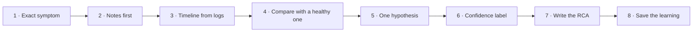

# 🔎 RCA skill: evidence before cause

**Problem.** When something breaks, the first explanation that sounds right tends to become "the root cause", and the AI is very good at sounding right. A wrong RCA is worse than none: the real problem stays, and everyone stops looking.

**What I built.** A Claude Code skill with one rule: **no root cause without evidence, no fix without a root cause.** "Not proven yet, the next check is X" is a valid answer. A guess presented as a cause is not.

**The rules that matter**
- **Only real timestamps.** A time goes on the timeline only if it was copied from a log line or a database field, never estimated.
- **Compare with a healthy twin.** The same model on the same kind of host, working fine. The difference is the evidence.
- **Two symptoms in one window are often one failure** seen by two layers. Put them on one timeline before treating them separately.
- **A confidence label on every cause:** proven, likely, or not proven yet.
- **It starts on its own.** When a fix has failed twice, the troubleshooting flow hands over to this skill instead of trying a third guess.
- **Customer-ready output** in the team's RCA format, written in plain language.

**Built with:** Claude Code skill, read-only log access through [keychain wrappers](../zero-password-agent-access/).

🧰 **Install it:** [`rca`](https://github.com/Parag-S-Salunkhe/claude-code-skills/tree/main/skills/rca) in my [claude-code-skills](https://github.com/Parag-S-Salunkhe/claude-code-skills) repo.

[← AI Lab](../README.md)
