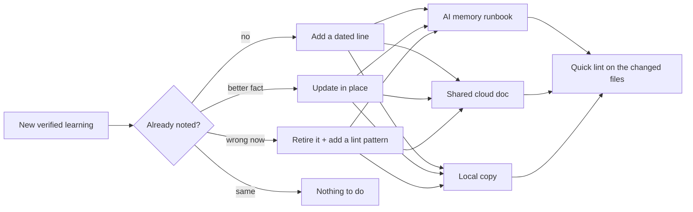

# 💾 Save-learnings skill

**Problem.** The most expensive thing in ops is learning the same fix twice. Chat history doesn't count as memory: next week's session won't find it, and neither will a teammate.

**What I built.** A Claude Code skill that runs whenever a fix, an onboarding or a workflow run turns up something new. It decides where the learning belongs and writes it to **three places in the same turn**:

**Rules**
- **Verified only.** A learning is saved after it worked, not when it sounds right.
- **Find it by the exact error text.** Fixes are filed under the exact message people will search for.
- **No secrets, no customer data.** Ever.
- **Retire old ways properly.** When a method is replaced, the old text becomes a lint pattern so it can't creep back ([self-checking runbooks](../self-checking-runbooks/)).

**Built with:** Claude Code skill, Markdown runbooks, a cloud doc connector, Python lint.

🧰 **Install a generic version:** [`save-learnings`](https://github.com/Parag-S-Salunkhe/claude-code-skills/tree/main/skills/save-learnings) in my [claude-code-skills](https://github.com/Parag-S-Salunkhe/claude-code-skills) repo (same rules, no internal details).

[← AI Lab](../README.md)
