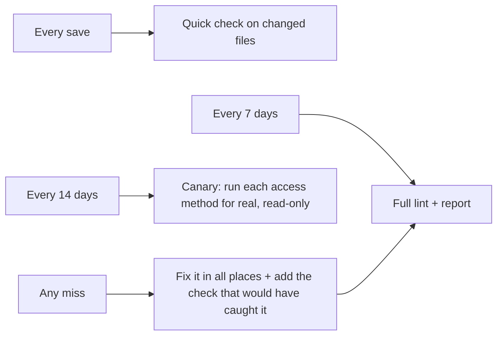

# 🧹 Self-checking runbooks

**Problem.** An AI that reads your runbooks is only as good as the runbooks. Old methods linger after they're replaced. A cancelled plan still reads as current. A secret gets pasted into a note. Nobody notices until the AI confidently uses the wrong thing.

**What I built.** A lint for my knowledge base (memory files, docs, skills) that runs on its own:

| Check | Catches |
|---|---|
| Leaked secrets | passwords, tokens or keys in any note: replaced with the name of the key, never echoed |
| Retired methods | 22 patterns of "the old way", each with a real example so the check tests itself |
| Superseded facts | plans that were cancelled or replaced but still read as current |
| Dead links & paths | files, sections and scripts that moved |
| Drift | the cloud doc vs its local copy, CI job inputs vs last snapshot |
| Size & shape | index too long to load, missing headers, duplicate entries |

**The rule that made it work: every miss ends with a check.** When something slips (a stale fact, a wrong answer), fixing that one case isn't enough. The same turn adds the guard: a retired pattern, a superseded entry, a canary probe, or an eval question. Then it logs a row in a changelog: what slipped, why the check missed it, what was added.

**Results**
- Found a retired method still taught in 6 places, 12 days after it was replaced. It's now a pattern, so it can't come back quietly.
- Moved every secret out of notes into an auto-locking keychain (see [zero-password access](../zero-password-agent-access/)).
- Reports everything, changes nothing without my "yes".

**Built with:** Claude Code, Python (~700-line linter + small helpers), a SessionStart hook for the weekly run.

🧰 **Install a generic version:** [`notes-lint`](https://github.com/Parag-S-Salunkhe/claude-code-skills/tree/main/skills/notes-lint) in my [claude-code-skills](https://github.com/Parag-S-Salunkhe/claude-code-skills) repo (same rules, no internal details).

[← AI Lab](../README.md)
