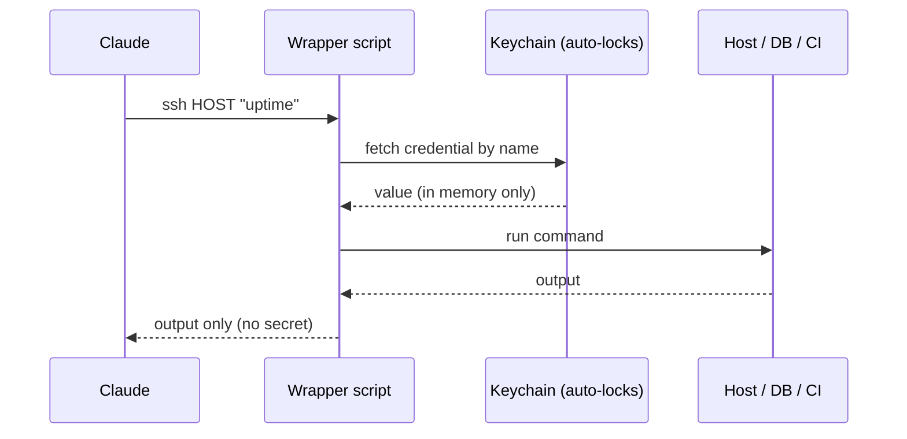

# 🔐 Zero-password agent access

**Problem.** I wanted Claude to SSH into hosts, query production (read-only) and call CI, without passwords ever being in a prompt, a file, a transcript or my shell history.

**What I built.** Small wrapper scripts. The agent calls a wrapper with *what* to do. The wrapper fetches the credential itself from an auto-locking macOS Keychain and uses it in-process. The value never prints.

**Layers**
- **One plain command per action.** e.g. `ssh-wrapper <host> "<cmd>"` and `db-query "<SELECT ...>"`. Easy to allow-list, easy to read in a log.
- **Read-only by default.** The DB wrapper refuses anything that is not a single read statement (`SELECT`, `SHOW`, `DESCRIBE`, `EXPLAIN`).
- **Deny rules.** Claude Code permissions block reading the secret store and the raw secret commands directly.
- **Scans.** A secret scanner runs over notes and skills. A weekly Mac check covers keychain lock settings and exposed files.
- **Adding a secret** happens in a separate terminal window that Claude never sees.

**Rule:** never display lines from a secrets file, not even "masked". Only `file:line:kind`.

**Built with:** Python, macOS `security` (Keychain), Claude Code permissions.

[← AI Lab](../README.md)
